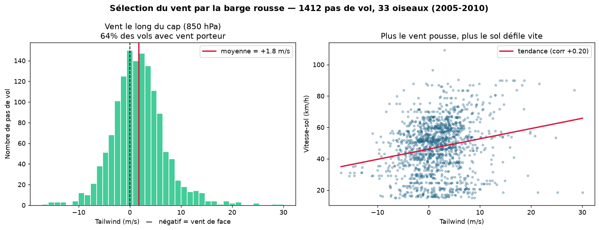
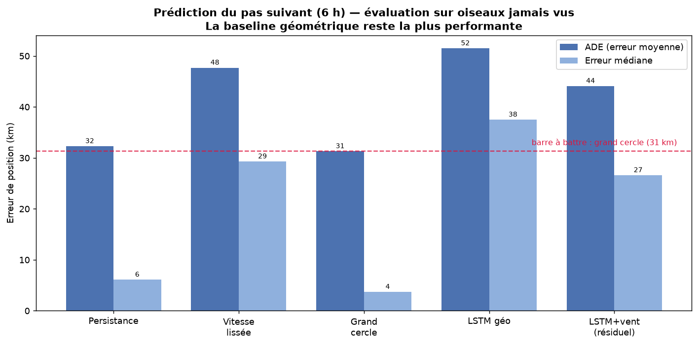

# Predicting Bar-tailed Godwit Migration Trajectories

Analysis and short-term prediction of **bar-tailed godwit** (*Limosa lapponica*) migration
routes, combining real satellite tracking data with ERA5 wind reanalysis.

The bar-tailed godwit holds the record for the longest non-stop flight in the animal kingdom
(~13,560 km, Alaska to Tasmania, 11 days without landing or feeding). Published work has shown
that the bird **selects its departure window and route according to supporting winds**. This
project takes that established biological fact and asks a data-science question:

**Wind guides the bird — but does it help *predict* the bird's trajectory?**

---

## Key findings

The answer comes in two parts, and the tension between them is the point of the project.

**1. Wind selection is real and measurable (descriptive).**
Across 1,412 flight steps, the godwit flies preferentially when the wind pushes it:
**64% of flight steps have a tailwind** (wind component along the heading > 0), with a positive
mean tailwind. This reproduces the published "wind selection" result on independent data.

**2. Wind does not measurably improve prediction (predictive).**
An ablation study across 5 train/test splits shows that adding wind as an input feature yields
**no detectable improvement** in next-step prediction (mean gain ≈ 0 km; the effect is smaller
than the sampling variance from having only 8 test birds).

**Why these two results are consistent, not contradictory:** wind selection lives in the bird's
*behaviour*, but for short-term prediction, the bird's **recent kinematics (heading, speed)
already encode the effect of the wind it chose**. An explicit wind feature becomes redundant.
Consequently, a simple geometric baseline — projecting the next position along the great circle —
remains the strongest predictor.

| Model (test set, birds never seen in training) | ADE (km) | Median (km) |
|---|---:|---:|
| Persistence (constant velocity) | 32.3 | 6.1 |
| **Great circle (reference baseline)** | **31.3** | **3.7** |
| LSTM (geometry only) | 51.5 | 37.5 |
| LSTM + wind (residual) | 44.1 | 26.6 |




**Short vs. long horizon.** Recalibrated at each step, the geometric prediction tracks the real
route closely across a full 9-day Pacific crossing. Left to run free (autoregressive rollout),
error accumulates and the prediction diverges — a concrete illustration of why long-horizon
trajectory prediction is hard. Interactive maps are in `reports/figures/`.

---

## Data

- **Trajectories** — [Tracking Data for Bar-tailed Godwits](https://doi.org/10.5066/P9A9BYQW),
  Gill et al. 2023, U.S. Geological Survey (public domain). Argos satellite data, 63 birds,
  2005–2010. The `diag_filteredLocations` table carries a plausibility flag and a tracking-status
  field (alive / dead / shed).
- **Wind** — [ERA5 on pressure levels](https://cds.climate.copernicus.eu/), Copernicus Climate
  Change Service. u/v wind components at 925 and 850 hPa, downloaded only over the space-time
  windows where birds actually flew.

Raw data is not versioned (see `.gitignore`); the ingestion scripts regenerate it. ERA5 access
requires an ECMWF account and a `~/.cdsapirc` file.

---

## Approach

The pipeline is a chain of decisions, each following from what the previous step revealed.

**From raw Argos to clean trajectories.** Argos fixes are irregular in time (sometimes several
per hour, sometimes multi-day gaps) and vary in accuracy. Positions were filtered on the built-in
plausibility flag and on `alive` status, then split into continuous "legs" by cutting at gaps
longer than 48 h — a threshold chosen by inspecting where the transmitter duty-cycle created a
natural break in the gap distribution, not picked arbitrarily. Each leg was resampled onto a
regular 6-hour grid aligned to 00/06/12/18 UTC. Interpolation uses **spherical linear
interpolation (slerp)** along the great circle rather than naive lat/lon averaging: on a single
long flight step, the naive method placed the interpolated point ~99 km off the true route.

**From positions to wind features.** Per-step kinematics (heading, ground speed, turning angle)
were computed leg by leg. ERA5 wind was joined to each flight position in space and time — the
6-hour UTC alignment chosen earlier made this join exact, with no temporal approximation. Wind was
decomposed relative to the bird's heading into **tailwind** (along-track) and **crosswind**
(cross-track). Comparing 925 vs 850 hPa, and a "best of both levels" strategy, gave indirect
evidence that the bird adjusts altitude to catch favourable winds.

**From analysis to prediction.** The problem is framed as predicting the next-step *displacement*
(Δlat, Δlon) rather than absolute position, for stationarity. Baselines (persistence, smoothed
velocity, great circle) set the bar, evaluated with ADE/FDE (Haversine-based) under a
**leave-birds-out split** so the model is always tested on birds it never trained on.

**Why the LSTM used residual learning.** A first LSTM trained to predict the full displacement
underperformed the great-circle baseline — diagnosed by measurement, not guesswork: its
predictions correlated ~0.98 with the truth but carried a per-step noise the exact geometric
formula does not. The fix was to have the network predict only the **residual** relative to the
great circle (the part geometry gets wrong: turns and accelerations), which is what wind should
explain. The ablation study then tested whether wind actually helps that residual — and, honestly,
it does not at this data scale.

### Notable design decisions
- Predict displacement, not absolute position (stationarity).
- Handle the antimeridian in 0–360° longitude for both analysis and mapping.
- Encode the cyclic heading as (sin, cos) for the network.
- Standardize using training-set statistics only; split by bird to prevent leakage.

---

## Stack

`pandas` · `numpy` · `xarray` + `netcdf4` · `cdsapi` (ERA5) · `scikit-learn` · `PyTorch` ·
`folium` + `matplotlib`

---

## Repository structure

```
src/godwit/
├── ingest/         # USGS & ERA5 download
├── preprocessing/  # resampling (slerp)
├── features/       # kinematics, wind decomposition, join
├── models/         # baselines, LSTM, training loop
├── evaluation/     # ADE/FDE metrics, rollout
├── data/           # windowing, split by bird
└── geo.py          # spherical primitives (Haversine, bearing)
```

---

## Reproduce

```bash
python -m venv .venv && source .venv/bin/activate
pip install -r requirements.txt

# Ingestion (ERA5 needs ~/.cdsapirc)
python download_usgs.py
python download_wind.py

# Clean, resample, features, wind join
python build_interim.py
python build_processed.py

# Baselines and model
python eval_baselines_split.py
python ablation_wind.py
```

---

## Limitations and next steps

- **Sample size.** ~540 flight-step examples cap what a deep model can learn; more birds would be
  needed to give an LSTM room to beat a well-designed geometric baseline.
- **Altitude.** Argos gives no reliable altitude, so the pressure level is an assumption.
- **Multi-step prediction.** The natural next experiment: predicting several steps ahead, where
  error accumulates and wind information might finally add value.

---

*This is a student portfolio project, built to learn an end-to-end data-science workflow — from
raw data ingestion to a reproducible, honestly-reported scientific result.*
